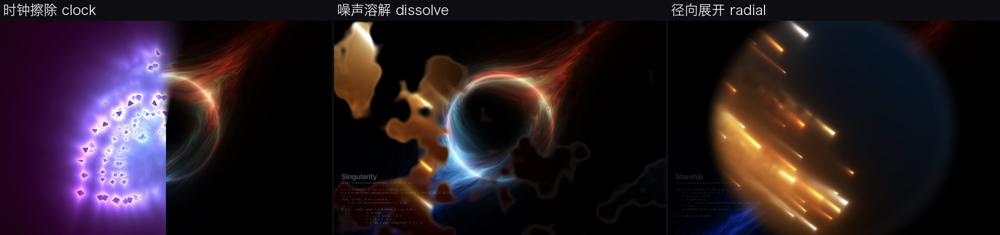

# Shader 屏保合集

把几个 Shadertoy 上的经典 shader 移植到 Metal，做成一个 macOS 屏保 **Shader Mix**：
随机轮播、带转场，并在左下角显示当前 shader 的标题、作者、许可和核心代码。

> **私有仓库，仅限个人使用。** 多数 shader 为 CC BY-NC-SA（禁止商用、需署名），
> Balatro 部分没有任何授权。请勿公开本仓库，也不要分发构建出的屏保。



## 特性

- **随机轮播**：每段默认 20 秒，不连续重复；多显示器各自独立随机。
- **四种转场**（约 2 秒，随机选）：交叉淡化、噪声溶解（带发光接缝）、圆形从中心展开、时钟擦除。
- **代码叠加**：大标题 + 作者/链接/许可一行 + 原作的核心代码摘录（原文，`// ...` 表示省略）。
  - 文字区域固定在左下角：启动时按最长的摘录量好高度，切换时标题和第一行代码都不跳动。
  - 文字在 GPU 上合成，按原生分辨率绘制。
  - 文字始终为浅色，背后的深色描边和光晕随画面亮度自适应，并在时间上平滑，不闪烁。
  - 转场时旧代码先淡出，新代码再淡入。
- **性能**：shader 按每屏最多 1920×1080 渲染，30fps。M4 Pro 上单个 shader 的 GPU 耗时为每帧 1～9ms，转场时约 9～11ms。
- **移植校验**：每个 shader 都和浏览器（WebGL）里渲染的原作逐像素对比过，见 `shader-mix/reference/`。

## Shader 一览

| | Shader | 作者 | 原始链接 | 许可 | 默认启用 |
|---|---|---|---|---|---|
|  | Flowing Wires | kishimisu | https://www.shadertoy.com/view/DsBczR | CC BY-NC-SA 4.0 | 是 |
|  | Starship | Xor（@XorDev） | https://www.shadertoy.com/view/l3cfW4 | 未声明，按 Shadertoy 默认 CC BY-NC-SA 3.0 | 是 |
|  | fractal pyramid | bradjamesgrant | https://www.shadertoy.com/view/tsXBzS | 未声明，按 CC BY-NC-SA 3.0 | 是 |
|  | Simplicity | JoshP | https://www.shadertoy.com/view/lslGWr | 未声明，按 CC BY-NC-SA 3.0 | 是 |
|  | Singularity | Xor（@XorDev） | https://www.shadertoy.com/view/3csSWB | 未声明，按 CC BY-NC-SA 3.0 | 是 |
|  | Ether | nimitz | https://www.shadertoy.com/view/MsjSW3 | CC BY-NC-SA 3.0 | 是 |
|  | Path to the colorful infinity | Benoit Marini（benoitM） | https://www.shadertoy.com/view/WtjyzR | CC BY-NC-SA 3.0 | 否（可选） |
|  | Balatro background | LocalThunk（游戏原作），xxidbr9 移植 | https://www.shadertoy.com/view/XXtBRr ・ https://github.com/xxidbr9/balatro-effect-recreate ・ https://www.playbalatro.com | **无授权，仅个人使用，不可分发** | 否（可选） |

移植说明：

- **自动转换**：多数 shader 原样保留 GLSL，构建时经 glslang 和 SPIRV-Cross 转成 Metal。
- **Flowing Wires**：原作的宏和逗号表达式无法自动转换，手工改写成函数，数学和求值顺序不变，与原作逐像素一致。
- **Starship**：用到 Shadertoy 内置的一张噪声贴图，已从 Shadertoy 下载，见 `shader-mix/saver/textures/`。
- **Path to the colorful infinity**：`o/dot(o,o)` 改写为 `o*(1./dot(o,o))`，画面不变，快约 8 倍。
- **Balatro**：使用游戏里的默认参数，外加一层 `mainImage` 包装。

## 安装

**普通安装不需要 Xcode，也不需要任何开发环境。** 仓库里带了预编译的通用版（Apple Silicon + Intel，ad-hoc 签名）：
`dist/ShaderMix.zip`，GitHub Release 里也有同一份。

```bash
git clone https://github.com/jokerlee/shader-screensavers.git   # 私有仓库：需先用 jokerlee 账号登录（gh auth login）
cd shader-screensavers
./install.sh
```

`install.sh` 依次完成以下步骤：

1. 检查系统版本，要求 macOS 13 以上。
2. 解压预编译版；如果仓库里没有 `dist/`，用 `gh release download` 下载最新 Release。
3. 备份旧版到 `~/Library/Screen Savers/ShaderMix.saver.backup`，安装到 `~/Library/Screen Savers/`。
4. 去掉隔离属性，重启屏保进程。
5. 打开「系统设置 → 屏幕保护程序」，在「其他」里选 **Shader Mix** 即可。

| 用法 | 说明 |
|---|---|
| `./install.sh` | 安装预编译版（默认） |
| `./install.sh --build` | 从源码构建再安装，只需要命令行工具：`xcode-select --install` |
| `./install.sh --no-open` | 装完不打开系统设置（可与 `--build` 一起用） |
| `./install.sh --uninstall` | 把已安装的屏保移到废纸篓 |

从源码构建的说明：

- 不需要 Xcode，也不需要离线 Metal 编译器。shader 以 Metal 源码打包，屏保加载时由显卡驱动编译。
- GLSL → Metal 的转换工具 glslang 和 spirv-cross 是可选的：安装了（`brew install glslang spirv-cross`）就重新转换，没装就用仓库里已转换好的 `shader-mix/saver/generated/`。
- 刷新预编译包：`./shader-mix/saver/package.sh`，会生成 `dist/ShaderMix.zip`。

## 参数（`shader-mix/saver/configure.sh`）

`./shader-mix/saver/configure.sh <参数> <值>` 会修改 `Info.plist` 里的默认值，然后从源码重新构建、安装，并重启屏保进程（需要命令行工具）。不带参数运行可以查看当前值和可选的 shader。

| 参数 | 默认 | 说明 |
|---|---|---|
| `shaders` | `flowingwires,starship,fractalpyramid,simplicity,singularity,ether` | 启用哪些 shader，逗号分隔；可选 `colorfulinfinity`、`balatroswirl` |
| `segmentSeconds` | 20 | 每个 shader 的播放时长（秒） |
| `transitionSeconds` | 2 | 转场时长（秒） |
| `transitions` | `fade,dissolve,radial,clock` | 从中随机选用的转场 |
| `startTimeJitter` | 30 | 每段从 shader 时间轴 [0, 30) 秒内的随机位置开始 |
| `framesPerSecond` | 30 | 帧率上限 |
| `renderScale` | 1.0 | shader 渲染的每点像素数；文字始终按原生分辨率 |
| `maxRenderPixels` | 2073600 | 每屏 shader 渲染像素上限（1920×1080） |
| `showCode` | true | 是否显示代码叠加 |
| `codeOpacity` | 0.9 | 文字不透明度 |
| `codeHalo` | 0.85 | 文字深色描边/光晕强度（亮背景时自动加强） |
| `codeScale` | 1.0 | 字号倍数（代码约为屏高的 1/80，标题约 2.7 倍） |
| `logStats` | false | 每 10 秒和每次转场时在系统日志里输出帧率和 GPU 耗时 |

示例：

```bash
./shader-mix/saver/configure.sh segmentSeconds 30
./shader-mix/saver/configure.sh shaders flowingwires,singularity,colorfulinfinity,balatroswirl
./shader-mix/saver/configure.sh transitions dissolve,radial
./shader-mix/saver/configure.sh showCode false
```

## 目录

| 路径 | 内容 |
|---|---|
| `install.sh` | 一键安装、卸载 |
| `dist/ShaderMix.zip` | 预编译的通用版屏保 |
| `shader-mix/saver/` | 屏保源码：`ShaderMixView.swift`、`Info.plist`、`build.sh`、`package.sh`、`configure.sh`、`README.md` |
| `shader-mix/saver/generated/` | 已转换好的 Metal shader；没有 glslang 和 spirv-cross 时使用 |
| `shader-mix/saver/shaders/` | 各 shader 的 GLSL 源（`<key>.glsl`）、叠加用的代码摘录（`<key>.excerpt.glsl`）、`manifest.json`（标题、作者、许可） |
| `shader-mix/saver/tools/` | `gen_metal.py`（构建时 GLSL→Metal）、`make_sources.py`（一次性从 Shadertoy JSON 生成源文件） |
| `shader-mix/reference/` | 浏览器渲染的原作参照图，用于移植校验 |
| `common/CodeText.swift` | 代码叠加：文字遮罩排版与 GPU 着色 |
| `candidates/` | 选型时拉取的 24 个 Shadertoy 原始 JSON、实测 GPU 耗时、总览图和测量工具 |
| `docs/screenshots/` | 本文截图 |

## 致谢与许可

所有 shader 的版权归原作者所有，本仓库只是个人学习和自用的移植：

- kishimisu、Xor、bradjamesgrant、JoshP、nimitz、Benoit Marini 的作品均来自 Shadertoy。
  - 许可为 CC BY-NC-SA 3.0 或 4.0；作者未声明的，按 Shadertoy 默认的 CC BY-NC-SA 3.0。
  - 要求署名、禁止商用，衍生作品须使用相同许可。
- Balatro 背景 shader 的原作者是 LocalThunk，出自游戏《Balatro》，由 xxidbr9 移植。
  - 没有任何开源授权，此处仅作个人使用，不得公开或分发。
- `candidates/src` 中其他 shader 的作者与许可见 `candidates/README.md`。
- 移植、屏保框架和工具代码仅供个人使用。
