[English](README.en.md) | **中文**

# Shader 屏保合集

把 13 个 Shadertoy / OpenProcessing 上的 shader 移植到 Metal，做成一个 macOS 屏保 **Shader Mix**：
随机轮播、带转场，并在左下角显示当前 shader 的标题、作者、许可和核心代码。

> **私有仓库，仅限个人使用。** 多数 shader 为 CC BY-NC-SA（禁止商用、需署名），
> Balatro 部分没有任何授权。请勿公开本仓库，也不要分发构建出的屏保。

## 特性

- **随机轮播**：默认启用全部 13 个 shader，每段 20 秒，不连续重复；多显示器各自独立随机。
- **四种转场**（约 2 秒，随机选）：交叉淡化、噪声溶解（带发光接缝）、圆形从中心展开、时钟擦除。
- **代码叠加**：大标题 + 作者/链接/许可一行 + 原作的核心代码摘录（原文，`// ...` 表示省略）。
  - 文字区域固定在左下角：启动时按最长的摘录量好高度，切换时标题和第一行代码都不跳动。
  - 文字在 GPU 上合成，按原生分辨率绘制。
  - 文字始终为浅色，背后的深色描边和光晕随画面亮度自适应，并在时间上平滑，不闪烁。
  - 转场时旧代码先淡出，新代码再淡入。
- **性能**：shader 按每屏最多 1920×1080 渲染，30fps。M4 Pro 上单个 shader 的 GPU 耗时为每帧 1～9ms，转场时约 9～11ms。
- **移植校验**：每个 shader 都和浏览器（WebGL）里渲染的原作逐像素对比过，见 `shader-mix/reference/`。

## 转场

下面的动图用屏保自己的转场 shader 离线渲染，关闭了代码叠加，工具见 `shader-mix/saver/tools/transition_demo/`。

<table>
<tr>
<td width="50%">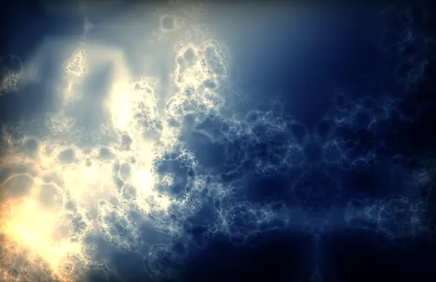<br>交叉淡化 <code>fade</code></td>
<td width="50%">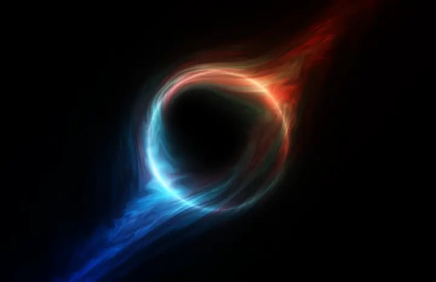<br>噪声溶解 <code>dissolve</code></td>
</tr>
<tr>
<td width="50%">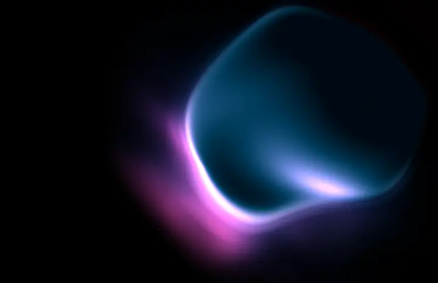<br>径向展开 <code>radial</code></td>
<td width="50%">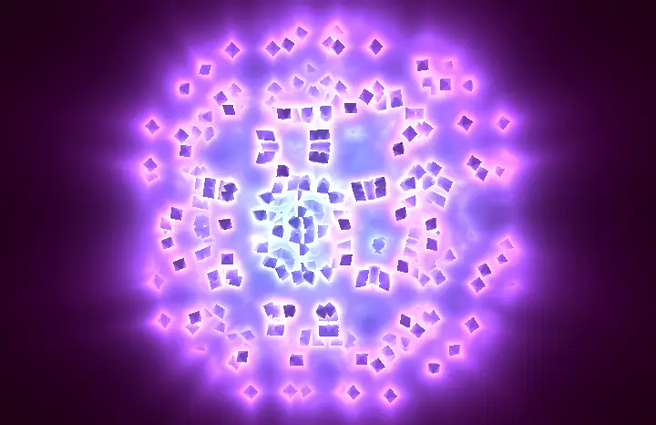<br>时钟擦除 <code>clock</code></td>
</tr>
</table>

## Omarchy 版

`omarchy/` 下是同一个 Shader Mix 在 Omarchy（Arch + Hyprland）上的移植：相同的 shader、转场和代码叠加，替换 Omarchy 自带的屏保。安装：`cd omarchy && ./install.sh`，详见 [omarchy/README.md](omarchy/README.md)。

## 安装

**普通安装不需要 Xcode，也不需要任何开发环境。** 预编译的通用版（Apple Silicon + Intel，ad-hoc 签名）发布在
[Releases](https://github.com/jokerlee/shader-screensavers/releases) 里。

```bash
gh auth login                                   # 私有仓库：用有权限的账号（jokerlee）登录
gh repo clone jokerlee/shader-screensavers
cd shader-screensavers
./install.sh
```

`install.sh` 依次完成以下步骤：

1. 检查系统版本，要求 macOS 13 以上。
2. 用 `gh release download` 下载最新 Release 的 `ShaderMix.zip`。
3. 备份旧版到 `~/Library/Screen Savers/ShaderMix.saver.backup`，安装到 `~/Library/Screen Savers/`。
4. 去掉隔离属性，重启屏保进程。
5. 打开「系统设置 → 屏幕保护程序」，在「其他」里选 **Shader Mix** 即可。

| 用法 | 说明 |
|---|---|
| `./install.sh` | 下载最新 Release 并安装（默认） |
| `./install.sh --zip <路径>` | 安装本地已有的 `ShaderMix.zip`（例如手动下载的 Release 资产，或 `package.sh` 的产物） |
| `./install.sh --build` | 从源码构建再安装，只需要命令行工具：`xcode-select --install` |
| `./install.sh --no-open` | 装完不打开系统设置（可与其他选项一起用） |
| `./install.sh --uninstall` | 把已安装的屏保移到废纸篓 |

从源码构建的说明：

- 不需要 Xcode，也不需要离线 Metal 编译器。shader 以 Metal 源码打包，屏保加载时由显卡驱动编译。
- GLSL → Metal 的转换工具 glslang 和 spirv-cross 是可选的：安装了（`brew install glslang spirv-cross`）就重新转换，没装就用仓库里已转换好的 `shader-mix/saver/generated/`。
- 打包发布：`./shader-mix/saver/package.sh` 生成 `dist/ShaderMix.zip`（不入库），再上传为 Release 资产。

## 参数（`shader-mix/saver/configure.sh`）

`./shader-mix/saver/configure.sh <参数> <值>` 会修改 `Info.plist` 里的默认值，然后从源码重新构建、安装，并重启屏保进程（需要命令行工具）。不带参数运行可以查看当前值和可选的 shader。

| 参数 | 默认 | 说明 |
|---|---|---|
| `shaders` | 全部 13 个 | 启用哪些 shader，逗号分隔，配置名见下方各 shader |
| `segmentSeconds` | 20 | 每个 shader 的播放时长（秒） |
| `transitionSeconds` | 2 | 转场时长（秒） |
| `transitions` | `fade,dissolve,radial,clock` | 从中随机选用的转场（默认全部） |
| `startTimeJitter` | 30 | 每段从 shader 时间轴 [0, 30) 秒内的随机位置开始 |
| `framesPerSecond` | 30 | 帧率上限 |
| `renderScale` | 1.0 | shader 渲染的每点像素数；文字始终按原生分辨率 |
| `maxRenderPixels` | 2073600 | 每屏 shader 渲染像素上限（1920×1080） |
| `showCode` | true | 是否显示代码叠加 |
| `codeOpacity` | 0.9 | 文字不透明度 |
| `codeHalo` | 0.85 | 文字深色描边/光晕强度（亮背景时自动加强） |
| `codeScale` | 1.0 | 字号倍数（代码约为屏高的 1/80，标题约 2.7 倍） |
| `logStats` | false | 每 10 秒和每次转场时在系统日志里输出帧率和 GPU 耗时 |

示例：

```bash
./shader-mix/saver/configure.sh segmentSeconds 30
./shader-mix/saver/configure.sh shaders flowingwires,singularity,balatroswirl
./shader-mix/saver/configure.sh transitions dissolve,radial
./shader-mix/saver/configure.sh showCode false
```

## Shader

截图是屏保在 MacBook（1728×1117）上的整屏画面；左下角代码在原生分辨率下清晰，缩小后看不清，所以每个 shader 下方另附了同样的代码文本。

### Flowing Wires

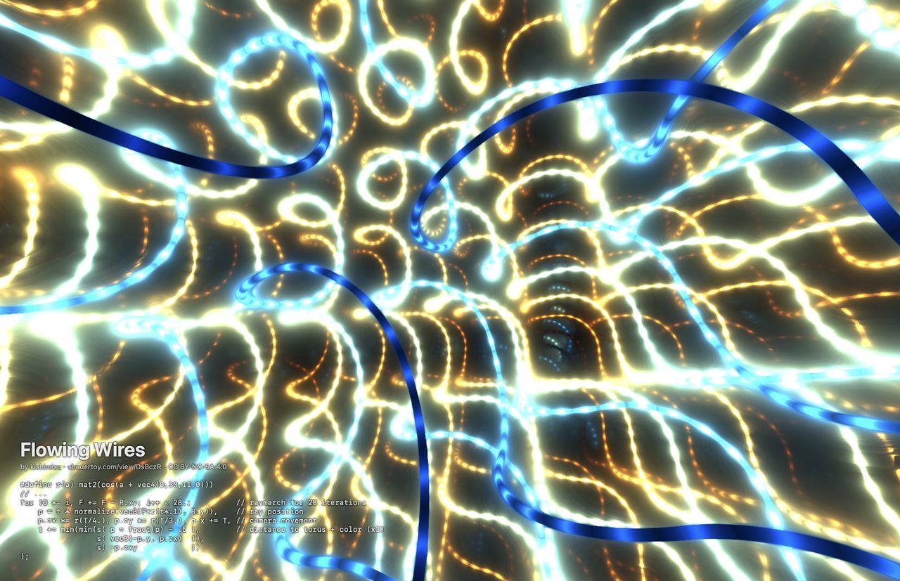

- 作者：kishimisu
- 原始链接：https://www.shadertoy.com/view/DsBczR
- 许可：CC BY-NC-SA 4.0
- 配置名：`flowingwires`

3D truchet 管道，28 步光线步进，霓虹线条持续流动。原作的宏与逗号表达式手工改写成函数，数学和求值顺序不变。

```glsl
#define r(a) mat2(cos(a + vec4(0,33,11,0)))
// ...
for (O *= i, F += F - R.xy; i++ < 28.;          // raymarch for 28 iterations
    p = t * normalize(vec3(F*r(t*.1), R.y)),    // ray position
    p.zx *= r(T/4.), p.zy *= r(T/3.), p.x += T, // camera movement
    t += min(min(s( p = fract(p) - .5 ),        // distance to torus + color (x3)
                 s( vec3(-p.y, p.zx)  )),
                 s( -p.zxy            ))
);
```

### Starship

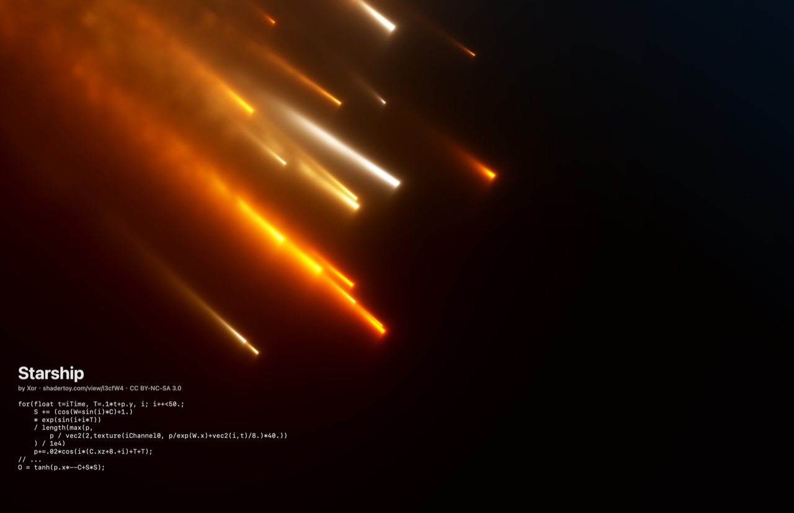

- 作者：Xor（@XorDev）
- 原始链接：https://www.shadertoy.com/view/l3cfW4
- 许可：未声明，按 Shadertoy 默认 CC BY-NC-SA 3.0
- 配置名：`starship`

50 个带拖尾的发光碎片，灵感来自 SpaceX 星舰第 7 次试飞的残骸。用到 Shadertoy 内置噪声贴图，已一并打包。

```glsl
for(float t=iTime, T=.1*t+p.y, i; i++<50.;
    S += (cos(W=sin(i)*C)+1.)
    * exp(sin(i+i*T))
    / length(max(p,
        p / vec2(2,texture(iChannel0, p/exp(W.x)+vec2(i,t)/8.)*40.))
    ) / 1e4)
    p+=.02*cos(i*(C.xz+8.+i)+T+T);
// ...
O = tanh(p.x*--C+S*S);
```

### Fractal Pyramid

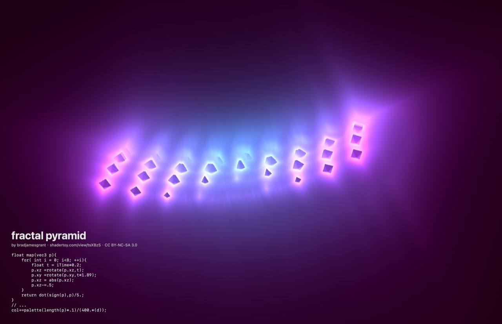

- 作者：bradjamesgrant
- 原始链接：https://www.shadertoy.com/view/tsXBzS
- 许可：未声明，按 CC BY-NC-SA 3.0
- 配置名：`fractalpyramid`

8 次旋转加折叠的分形距离场，用光线步进累积发光，形成旋转的霓虹金字塔。

```glsl
float map(vec3 p){
    for( int i = 0; i<8; ++i){
        float t = iTime*0.2;
        p.xz =rotate(p.xz,t);
        p.xy =rotate(p.xy,t*1.89);
        p.xz = abs(p.xz);
        p.xz-=.5;
    }
    return dot(sign(p),p)/5.;
}
// ...
col+=palette(length(p)*.1)/(400.*(d));
```

### Simplicity

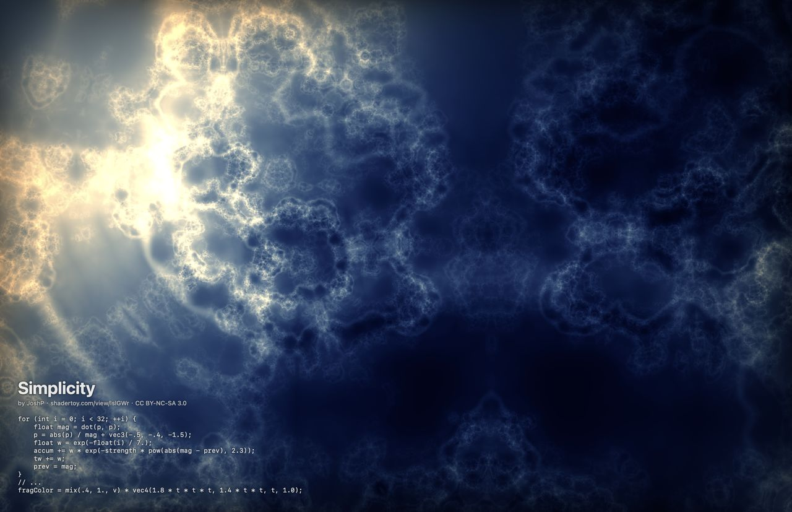

- 作者：JoshP
- 原始链接：https://www.shadertoy.com/view/lslGWr
- 许可：未声明，按 CC BY-NC-SA 3.0
- 配置名：`simplicity`

Kali 的 abs(p)/dot(p,p) 分形公式迭代 32 次，按迭代间的变化累积亮度，呈现星云般的云层。

```glsl
for (int i = 0; i < 32; ++i) {
    float mag = dot(p, p);
    p = abs(p) / mag + vec3(-.5, -.4, -1.5);
    float w = exp(-float(i) / 7.);
    accum += w * exp(-strength * pow(abs(mag - prev), 2.3));
    tw += w;
    prev = mag;
}
// ...
fragColor = mix(.4, 1., v) * vec4(1.8 * t * t * t, 1.4 * t * t, t, 1.0);
```

### Singularity

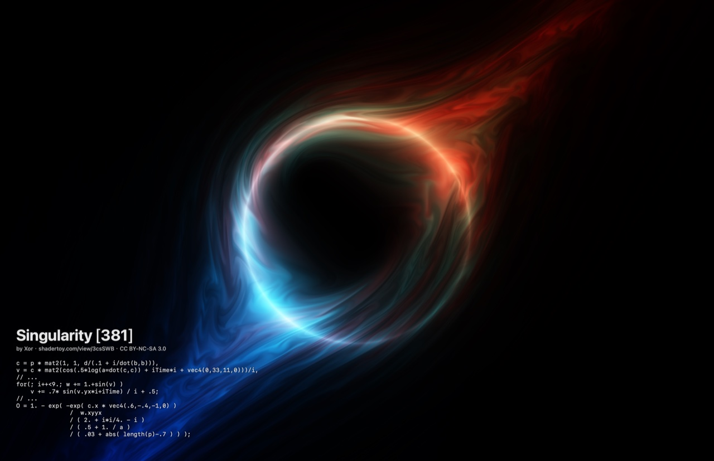

- 作者：Xor（@XorDev）
- 原始链接：https://www.shadertoy.com/view/3csSWB
- 许可：未声明，按 CC BY-NC-SA 3.0
- 配置名：`singularity`

把坐标透视、旋进螺旋，再叠加波动，得到带吸积盘的旋转黑洞，原版仅 381 字符。

```glsl
c = p * mat2(1, 1, d/(.1 + i/dot(b,b))),
v = c * mat2(cos(.5*log(a=dot(c,c)) + iTime*i + vec4(0,33,11,0)))/i,
// ...
for(; i++<9.; w += 1.+sin(v) )
    v += .7* sin(v.yx*i+iTime) / i + .5;
// ...
O = 1. - exp( -exp( c.x * vec4(.6,-.4,-1,0) )
               /  w.xyyx
               / ( 2. + i*i/4. - i )
               / ( .5 + 1. / a )
               / ( .03 + abs( length(p)-.7 ) ) );
```

### Ether

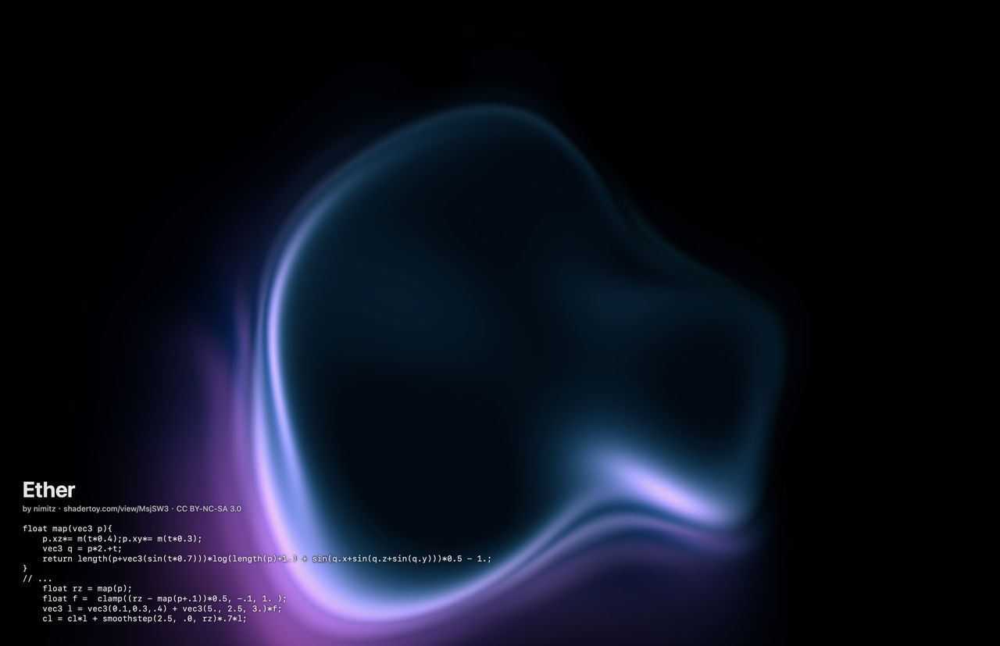

- 作者：nimitz
- 原始链接：https://www.shadertoy.com/view/MsjSW3
- 许可：CC BY-NC-SA 3.0
- 配置名：`ether`

只有 6 步的体积光线步进，用一层 sin 扰动的距离场做出发光的流体。

```glsl
float map(vec3 p){
    p.xz*= m(t*0.4);p.xy*= m(t*0.3);
    vec3 q = p*2.+t;
    return length(p+vec3(sin(t*0.7)))*log(length(p)+1.) + sin(q.x+sin(q.z+sin(q.y)))*0.5 - 1.;
}
// ...
    float rz = map(p);
    float f =  clamp((rz - map(p+.1))*0.5, -.1, 1. );
    vec3 l = vec3(0.1,0.3,.4) + vec3(5., 2.5, 3.)*f;
    cl = cl*l + smoothstep(2.5, .0, rz)*.7*l;
```

### Path to the Colorful Infinity

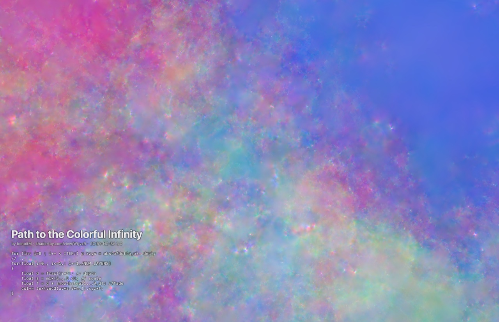

- 作者：Benoit Marini（benoitM）
- 原始链接：https://www.shadertoy.com/view/WtjyzR
- 许可：CC BY-NC-SA 3.0
- 配置名：`colorfulinfinity`

对 4D 点反复做球面反演、平移和折叠（Kaliset），17 层切片循环放大，形成无限穿梭的隧道。o/dot(o,o) 改写为 o*(1./dot(o,o))，画面不变，快约 8 倍。

```glsl
for (int i=0 ; i++ < ITER;) o.xzyw = abs(o/dot(o,o)- dec);
// ...
for(float i=0.; i<=1.; i+=1./NUM_LAYERS)
{
    float d = fract(i+t); // depth
    float s = mix(5.,.5,d); // scale
    float f = d * smoothstep(1.,.9,d); //fade
    col+= tex(vec3(uv*s,i*4.)).xyz*f;
}
```

### Balatro Background

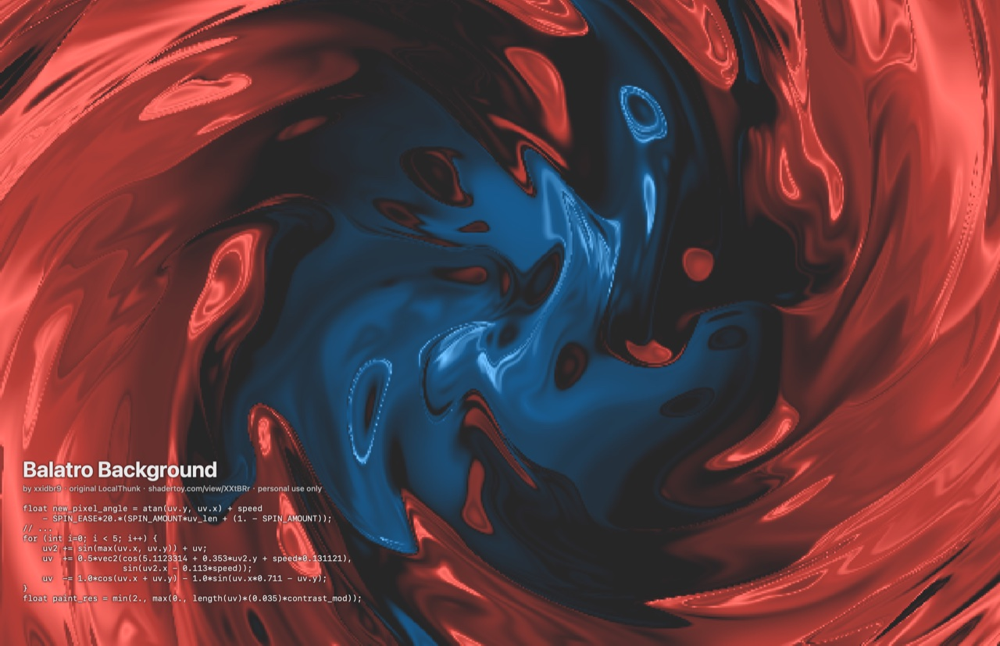

- 作者：LocalThunk（游戏原作），xxidbr9 移植
- 原始链接：https://www.shadertoy.com/view/XXtBRr ・ https://github.com/xxidbr9/balatro-effect-recreate ・ https://www.playbalatro.com
- 许可：**无授权，仅个人使用，不可分发**
- 配置名：`balatroswirl`

游戏《Balatro》的背景：像素化后做极坐标旋涡，再经 5 次 sin/cos 扰动出颜料感，最后在三种颜色间混合。

```glsl
float new_pixel_angle = atan(uv.y, uv.x) + speed
    - SPIN_EASE*20.*(SPIN_AMOUNT*uv_len + (1. - SPIN_AMOUNT));
// ...
for (int i=0; i < 5; i++) {
    uv2 += sin(max(uv.x, uv.y)) + uv;
    uv  += 0.5*vec2(cos(5.1123314 + 0.353*uv2.y + speed*0.131121),
                    sin(uv2.x - 0.113*speed));
    uv  -= 1.0*cos(uv.x + uv.y) - 1.0*sin(uv.x*0.711 - uv.y);
}
float paint_res = min(2., max(0., length(uv)*(0.035)*contrast_mod));
```

后 5 个来自小红书博主 MasterYeeeee 的作品解析视频所引用的原作，其中 4 个是 OpenProcessing 上 SamuelYAN 的 p5.js 片元着色器，转成 Shadertoy 的 mainImage 形式：坐标按 p5.js 在 Retina 屏上的 pixelDensity 2 换算；原作为 11:16 竖屏构图，这里围绕中心放大铺满横屏（16:10 下的倍数手调，更宽的屏再按宽度放大），与浏览器 WebGL 渲染的原代码逐像素对比过。

### Liquid Iridescence

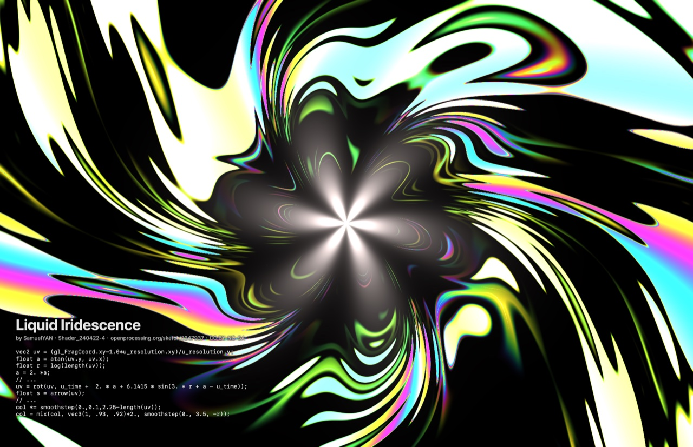

- 原作名：Shader_240422-4
- 作者：SamuelYAN（@samuelyan）
- 原始链接：https://openprocessing.org/sketch/2247937
- 许可：CC BY-NC-SA
- 配置名：`spiraliris`

在对数螺线里盛放的液态虹彩：极坐标取对数后旋转扭曲，从中心甩出液态金属般的虹彩。

```glsl
vec2 uv = (gl_FragCoord.xy-1.0*u_resolution.xy)/u_resolution.y;
float a = atan(uv.y, uv.x);
float r = log(length(uv));
a = 2. *a;
// ...
uv = rot(uv, u_time +  2. * a + 6.1415 * sin(3. * r + a - u_time));
float s = arrow(uv);
// ...
col *= smoothstep(0.,0.1,2.25-length(uv));
col = mix(col, vec3(1, .93, .92)*2., smoothstep(0., 3.5, -r));
```
### Cell Membrane Light

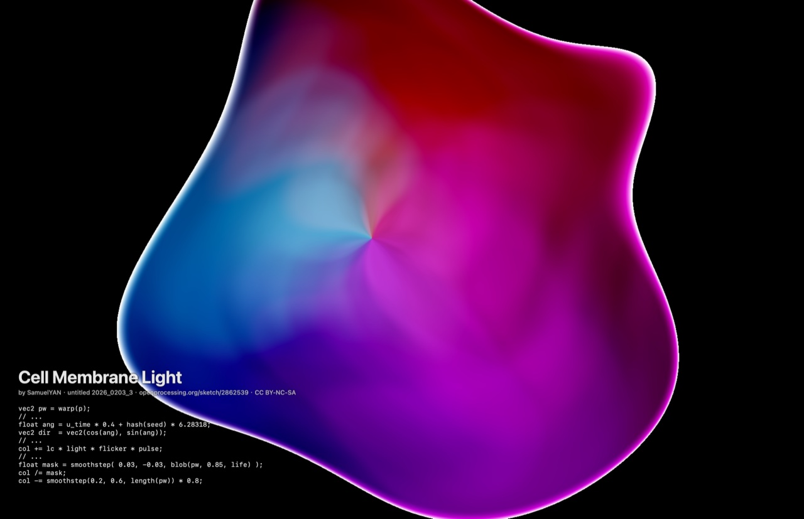

- 原作名：untitled 2026_0203_3
- 作者：SamuelYAN（@samuelyan）
- 原始链接：https://openprocessing.org/sketch/2862539
- 许可：CC BY-NC-SA
- 配置名：`membrane`

光在细胞膜内起舞：64 盏聚光灯在扭曲的空间里转动，被一个随“生命状态”起伏的细胞膜遮罩收住。

```glsl
vec2 pw = warp(p);
// ...
float ang = u_time * 0.4 + hash(seed) * 6.28318;
vec2 dir  = vec2(cos(ang), sin(ang));
// ...
col += lc * light * flicker * pulse;
// ...
float mask = smoothstep( 0.03, -0.03, blob(pw, 0.85, life) );
col /= mask;
col -= smoothstep(0.2, 0.6, length(pw)) * 0.8;
```
### Sixteen Motes

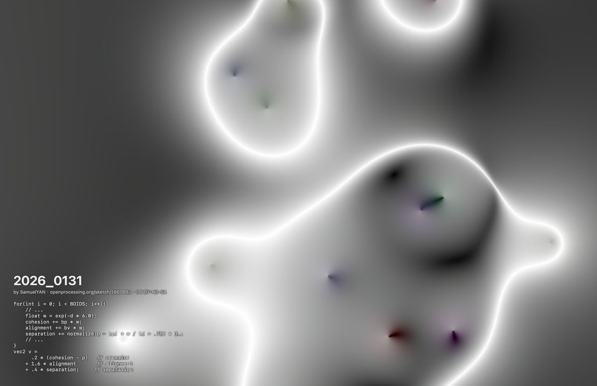

- 原作名：2026_0131
- 作者：SamuelYAN（@samuelyan）
- 原始链接：https://openprocessing.org/sketch/2860882
- 许可：CC BY-NC-SA
- 配置名：`motes`

当十六颗微尘在代码里彼此吸引：16 个伪 boid 的聚合、对齐、分离三种力构成一个场，画出相互吸引融合的发光轮廓。同组还有彩色版 GENUARY 2026_0131（openprocessing.org/sketch/2860834），未加入。

```glsl
for(int i = 0; i < BOIDS; i++){
    // ...
    float w = exp(-d * 6.0);
    cohesion += bp * w;
    alignment += bv * w;
    separation += normalize(p - bp) * w / (d + .75) * 3.;
    // ...
}
vec2 v =
      .2 * (cohesion - p)   // cohesion
    + 1.6 * alignment       // alignment
    + .4 * separation;     // separation
```
### The Hidden Line

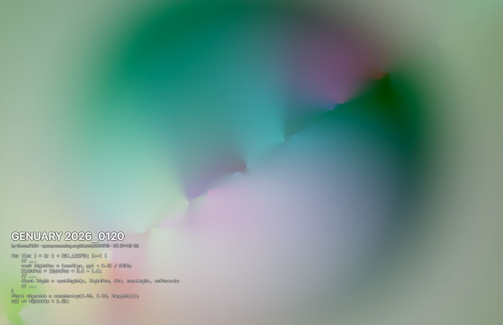

- 原作名：GENUARY 2026_0120
- 作者：SamuelYAN（@samuelyan）
- 原始链接：https://openprocessing.org/sketch/2851315
- 许可：CC BY-NC-SA
- 配置名：`hiddenline`

隐秘的一线：32 盏锁定在网格对角线上的聚光灯闪烁、呼吸，叠加暗角，形成柔光球体。

```glsl
for (int i = 0; i < NUM_LIGHTS; i++) {
    // ...
    vec2 lightPos = (vec2(gx, gy) + 0.5) / GRID;
    lightPos = lightPos * 2.0 - 1.0;
    // ...
    float light = spotlight(p, lightPos, dir, coneAngle, softness);
    // ...
}
float vignette = smoothstep(1.25, 0.75, length(p));
col -= vignette * 1.25;
```
### 4D Apollonian

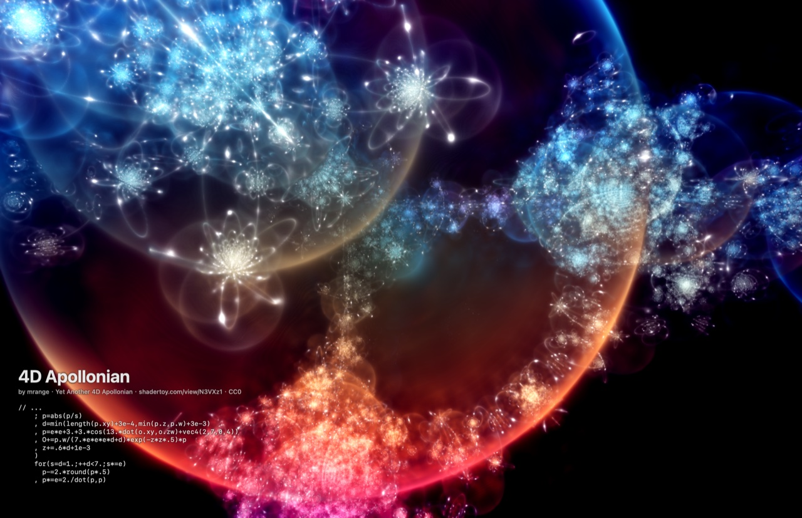

- 原作名：Yet Another 4D Apollonian
- 作者：mrange
- 原始链接：https://www.shadertoy.com/view/N3VXz1
- 许可：CC0
- 配置名：`apollonian4d`

四维之谜：四维阿波罗尼分形，三个平面连续旋转后投影，光线步进累积发光，星云般绚丽。

```glsl
// ...
    ; p=abs(p/s)
    , d=min(length(p.xy)+3e-4,min(p.z,p.w)+3e-3)
    , p=e*e+3.+3.*cos(13.*dot(o.xy,o.zw)+vec4(2,7,0,4))
    , O+=p.w/(7.*e*e*e*d+d)*exp(-z*z*.5)*p
    , z+=.6*d+1e-3
    )
    for(s=d=1.;++d<7.;s*=e)
      p-=2.*round(p*.5)
    , p*=e=2./dot(p,p)
```

## 目录

| 路径 | 内容 |
|---|---|
| `install.sh` | 一键安装、卸载 |
| `shader-mix/saver/` | 屏保源码：`ShaderMixView.swift`、`Info.plist`、`build.sh`、`package.sh`、`configure.sh`、`README.md` |
| `shader-mix/saver/shaders/` | 各 shader 的 GLSL 源（`<key>.glsl`）、叠加用的代码摘录（`<key>.excerpt.glsl`）、`manifest.json`（标题、作者、许可） |
| `shader-mix/saver/generated/` | 已转换好的 Metal shader；没有 glslang 和 spirv-cross 时使用 |
| `shader-mix/saver/tools/` | `gen_metal.py`（GLSL→Metal）、`make_sources.py`（从 Shadertoy JSON 生成源文件）、`transition_demo/`（离线渲染转场动图） |
| `shader-mix/reference/` | 浏览器渲染的原作参照图，用于移植校验 |
| `common/CodeText.swift` | 代码叠加：文字遮罩排版与 GPU 着色 |
| `candidates/` | 选型时拉取的 24 个 Shadertoy 原始 JSON、实测 GPU 耗时、总览图和测量工具；`candidates/xhs/` 是小红书来源的候选（OpenProcessing 源码、转换后的 GLSL、浏览器参照图） |
| `docs/screenshots/` | 本文截图与转场动图 |

## 致谢与许可

所有 shader 的版权归原作者所有，本仓库只是个人学习和自用的移植：

- kishimisu、Xor、bradjamesgrant、JoshP、nimitz、Benoit Marini、mrange 的作品来自 Shadertoy，SamuelYAN 的作品来自 OpenProcessing。
  - 许可为 CC BY-NC-SA 3.0 或 4.0；作者未声明的，按 Shadertoy 默认的 CC BY-NC-SA 3.0。
  - 要求署名、禁止商用，衍生作品须使用相同许可。
- Balatro 背景 shader 的原作者是 LocalThunk，出自游戏《Balatro》，由 xxidbr9 移植。
  - 没有任何开源授权，此处仅作个人使用，不得公开或分发。
- SamuelYAN 的 4 个 OpenProcessing 作品为 CC BY-NC-SA；mrange 的 Yet Another 4D Apollonian 为 CC0。
- Starship 使用的噪声贴图来自 Shadertoy 内置纹理。
- `candidates/src` 中其他 shader 的作者与许可见 `candidates/README.md`。
- 移植、屏保框架和工具代码仅供个人使用。
